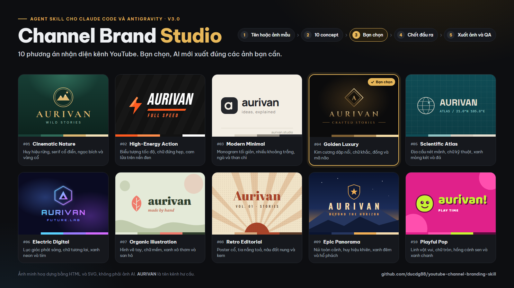
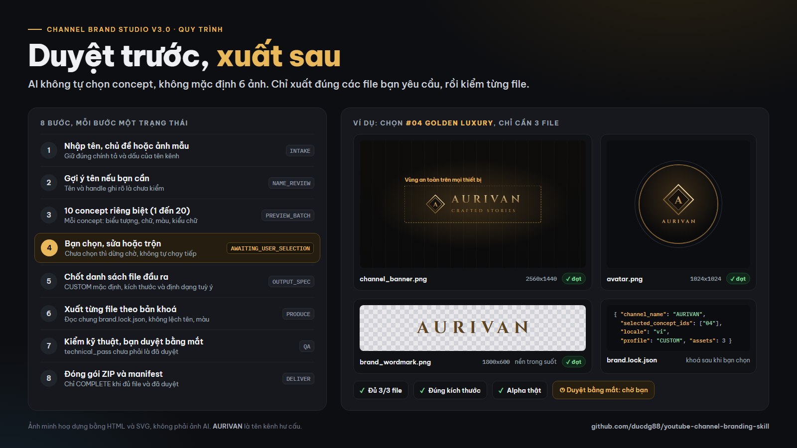

# Channel Brand Studio v3.0: 10 AI brand concepts for a YouTube channel

[Tiếng Việt](README.md) | **English**



  

An Agent Skill (`SKILL.md`) for **approval-first** YouTube channel branding. The agent proposes **10 genuinely different brand concepts** (symbol, name treatment, palette, typography), **you choose**, and only then does it export **exactly the files you ask for**, checking each one. Works with Claude Code, Google Antigravity, Gemini CLI, Codex and any agent that reads `SKILL.md`. Built and used in production by [DUCPT](https://ducpt.com/?utm_source=github&utm_medium=readme&utm_campaign=youtube-channel-branding-skill).

## What is new in v3.0

- **10 concept previews, not 10 finished images.** Default 10, any count from 1 to 20. Each concept is a full brand direction, not a colour swap.
- **The agent never picks for you.** Without your choice the job sits at `AWAITING_USER_SELECTION`.
- **No forced six-image kit.** You define the outputs: just avatar and banner (2 files), or add wordmark, horizontal logo, watermark, any size and format. The old six-image set is the optional `REFERENCE_6` profile.
- **One lock file**, `brand.lock.json`, written at approval so every later file keeps the same name, spelling and palette.
- **Honest QA.** Scripts check count, size, format and real transparency; `technical_pass` is not visual approval, a human still reviews.



## Workflow

| Step | State | Output |
|---|---|---|
| 1. Intake | `INTAKE` | Existing name, AI name ideas, or a reference image you have rights to |
| 2. Name review | `AWAITING_NAME_SELECTION` | Candidate names, clearance marked as unverified |
| 3. Concepts | `PREVIEWS_GENERATING` | 10 separate concept images (1 to 20) |
| 4. You select | `AWAITING_USER_SELECTION` | Pick, edit or mix (logo from 02, palette from 07) |
| 5. Output spec | `AWAITING_OUTPUT_SPEC` | File list, pixel sizes, formats, transparency |
| 6. Produce | `PRODUCTION` | Separate files that follow `brand.lock.json` |
| 7. QA | `REVIEW_REQUIRED` | Machine checks, waiting for your visual approval |
| 8. Deliver | `COMPLETE` | ZIP with files, manifest and QA report |

## Install

Copy `skills/channel-brand-studio` to where your agent loads skills:

| Agent | Copy to |
|---|---|
| Claude Code (all projects) | `~/.claude/skills/channel-brand-studio/` |
| Claude Code (one project) | `<project>/.claude/skills/channel-brand-studio/` |
| Google Antigravity | `<project>/.agents/skills/channel-brand-studio/` |
| Other agents | attach `SKILL.md`, `docs/WORKFLOW.md`, `docs/CLAUDE_BUILD_PROMPT.md` |

```bash
git clone https://github.com/ducdg88/youtube-channel-branding-skill.git
cp -r youtube-channel-branding-skill/skills/channel-brand-studio ~/.claude/skills/
pip install pillow   # for image QA
```

## Try the workflow (Python 3.9+)

Run inside `skills/channel-brand-studio`:

```bash
python scripts/studio.py init --dir ./test_job --niche "Example topic" --name "EXAMPLE BRAND" --count 10
# connect an image provider, save 10 real previews as test_job/previews/01.png ... 10.png
python scripts/studio.py check-previews --dir ./test_job
python scripts/studio.py select --dir ./test_job --ids 03
python scripts/studio.py lock-spec --dir ./test_job --spec configs/sample_custom_assets.json
# produce the files into test_job/final/, then:
python scripts/studio.py check-final --dir ./test_job
python scripts/studio.py approve-final --dir ./test_job --confirmed
python scripts/studio.py bundle --dir ./test_job
python tests/test_studio.py
```

The scripts manage state, write briefs and check files. They **do not call a paid image model** or deploy a website. Without an image provider the skill shows labelled concept proposals only.

## About the README images

Both images are built with HTML and SVG from `docs/demo/` (`cover.html`, `workflow.html`, `concepts.js`, `demo.css`). AURIVAN is a fictional channel name; these are not AI renders. Rebuild with headless Chrome:

```bash
chrome --headless=new --hide-scrollbars --window-size=1600,900 --virtual-time-budget=15000 --screenshot=docs/cover.png docs/demo/cover.html
```

## Legacy v1.3: universal-youtube-branding

`skills/universal-youtube-branding/` stays as it was: one brand, six images by default (`REFERENCE_6`), `MODE=NAME` (20 to 30 screened names and SEO), `MODE=VISUAL`, `MODE=FULL`, the `validate_assets.py`, `init_project.py`, `build_prompts.py` and `niche_router.py` scripts, and the GRAINVEYRA example in `examples/luxury_woodworking/`.

## Limits

- Name search helps screening only; it never proves a name or @handle is free. Check in YouTube Studio. No trademark search.
- Technical QA cannot catch misspelled text inside an image or an ugly logo; always review visually.
- Reference uploads need usage rights. Do not imitate another channel or brand.
- No fonts, API keys or customer channel data are included. Image quality depends on the provider you connect.

## About DUCPT

[DUCPT](https://ducpt.com/?utm_source=github&utm_medium=readme&utm_campaign=youtube-channel-branding-skill) builds AI tools, automation workflows and training for creators, YouTube channels and small businesses in Vietnam. More free skills: [DUCPT Skills](https://ducpt.com/skills/?utm_source=github&utm_medium=readme&utm_campaign=youtube-channel-branding-skill), [YouTube Title Lab](https://ducpt.com/skills/youtube-title-lab/?utm_source=github&utm_medium=readme&utm_campaign=youtube-channel-branding-skill).

## License

[MIT](LICENSE). Use, modify and share freely; keep the copyright line.
