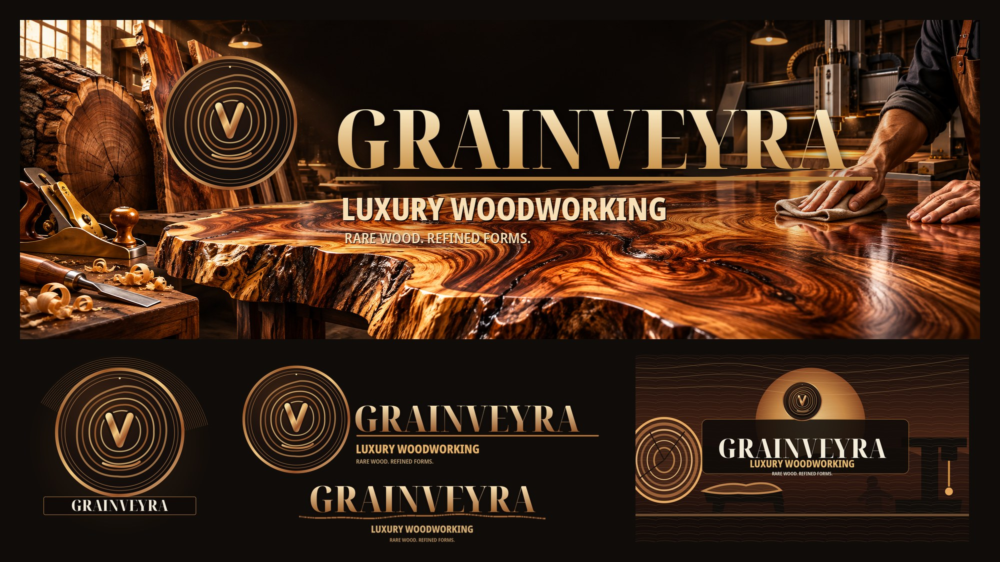

# Universal YouTube Branding Skill: bộ nhận diện kênh YouTube bằng AI

**Tiếng Việt** | [English](README.en.md)



  

Agent Skill (file `SKILL.md`) giúp AI làm trọn bộ nhận diện cho **kênh YouTube mới** ở mọi ngách: đặt tên kênh, SEO, logo, ảnh đại diện (avatar), ảnh bìa (banner, channel art), wordmark, rồi tự kiểm kích thước, nền trong suốt và vùng an toàn của YouTube. Dùng được với Google Antigravity, Claude Code, Gemini CLI, Codex và mọi agent đọc `SKILL.md`. Do [DUCPT](https://ducpt.com/?utm_source=github&utm_medium=readme&utm_campaign=youtube-channel-branding-skill) làm và dùng thật cho các kênh của mình.

## Skill làm ra gì

Mặc định (`ASSET_PROFILE=REFERENCE_6`) skill làm **6 ảnh độc lập**, cùng một thương hiệu:

| Số | File | Kích thước | Dùng để |
|---|---|---|---|
| 01 | `01_BANNER_CINEMATIC_2048x682.png` | 2048×682 | Banner toàn cảnh, cảnh ngách cộng logo và tên |
| 02 | `02_BATTLE_SCENE_A_1672x941.png` | 1672×941 | Cảnh kể chuyện A (16:9) |
| 03 | `03_LOGO_PLUS_NAME_TRANSPARENT_2048x682.png` | 2048×682 | Logo cộng tên, PNG nền trong suốt thật |
| 04 | `04_AVATAR_ROUND_1254x1254.png` | 1254×1254 | Ảnh đại diện tròn, đọc rõ ở 98 px |
| 05 | `05_WORDMARK_TRANSPARENT_2048x682.png` | 2048×682 | Logo chữ, PNG nền trong suốt thật |
| 06 | `06_BATTLE_SCENE_B_ALTERNATE_2048x1152.png` | 2048×1152 | Cảnh kể chuyện B, bố cục khác A |

Tên file `BATTLE_SCENE` giữ từ bản gốc để tương thích; dùng cho cảnh kể chuyện của mọi ngách, không riêng game.

Kèm ảnh bìa tải lên YouTube **2560×1440, dưới 6 MB**, mọi chữ và logo nằm trong vùng an toàn giữa (x 508 đến 2052, y 509 đến 932) theo [hướng dẫn của YouTube](https://support.google.com/youtube/answer/10456525). Muốn đúng 5 ảnh kiểu cũ thì ghi `ASSET_PROFILE=LEGACY_5`.

Ngoài ảnh, chế độ đầy đủ còn ra: `name_research.md` (20 đến 30 tên, sàng lọc trùng), `brand.lock.json` (khoá tên, màu, font, motif), `brand_guide.md`, `seo_keywords.csv`, `content_ideas.md`, `prompts_final.md`, `manifest.json`, `qa_report.json`, `README_upload.md`.

## Cài đặt

Tải repo về rồi chép thư mục `skills/universal-youtube-branding` vào chỗ agent của bạn đọc skill:

| Agent | Chép vào |
|---|---|
| Google Antigravity (một dự án) | `<thư mục dự án>/.agents/skills/universal-youtube-branding/` |
| Google Antigravity (mọi dự án) | `~/.gemini/config/skills/universal-youtube-branding/` |
| Claude Code | `~/.claude/skills/universal-youtube-branding/` hoặc `<dự án>/.claude/skills/...` |
| Agent khác đọc `SKILL.md` | thư mục skills của agent đó |

```bash
git clone https://github.com/ducdg88/youtube-channel-branding-skill.git
cp -r youtube-channel-branding-skill/skills/universal-youtube-branding ~/.claude/skills/
pip install pillow   # cho script kiểm ảnh
```

Mở lại agent nếu skill chưa hiện.

## Cách dùng

Gõ lệnh hoặc nói tự nhiên ("làm bộ nhận diện cho kênh tài liệu vũ trụ"):

```
/universal-youtube-branding MODE=FULL NICHE="Luxury Woodworking" STYLE=AUTO MARKET=Global
/universal-youtube-branding MODE=NAME NICHE="Space Documentary" MARKET=Global
/universal-youtube-branding MODE=VISUAL BRAND_NAME="My Channel" NICHE="AI Tutorials" STYLE=AUTO
/universal-youtube-branding MODE=FULL NICHE="Nature Mysteries" STYLE=REFERENCE
```

- `MODE=NAME`: nghiên cứu ngách, từ khoá, đặt 20 đến 30 tên, sàng lọc trùng tên và @handle, SEO. Không tạo ảnh.
- `MODE=VISUAL`: đã có tên, tạo 6 ảnh cộng ảnh bìa YouTube, rồi QA. Không tự đổi tên đã chốt.
- `MODE=FULL`: làm từ A đến Z (NAME, khoá thương hiệu, VISUAL, QA, hướng dẫn tải lên).
- `STYLE=AUTO` (mặc định): AI tự chọn màu, motif, font theo ngách. `STYLE=REFERENCE`: theo bố cục ảnh mẫu bạn đưa (chỉ lấy bố cục, không chép logo hay nhân vật). `STYLE=HYBRID`: trộn hai cách.
- Video dài: ghi `long-form` hoặc `video dài`, skill khoá `content_format=LONG_FORM` và không lái sang Shorts hay meme.
- Kênh tiếng Tây Ban Nha hay ngôn ngữ khác: giữ đúng dấu của tên gốc, mọi chữ phụ và SEO viết bằng ngôn ngữ đó.

### Cần máy tạo ảnh

Skill là quy trình và bộ kiểm, **ảnh do máy tạo ảnh AI của agent vẽ**. Antigravity có sẵn máy tạo ảnh. Ở agent khác, bạn cần nối một model tạo ảnh. Lưu ý: model tạo ảnh Gemini qua API **không có trong gói miễn phí**, phải bật thanh toán. Không có máy tạo ảnh thì skill chỉ xuất prompt và báo `IMAGE GENERATION NOT AVAILABLE`, không giả vờ đã có ảnh. AI viết sai chữ thì skill giữ cảnh và dặm lại chữ cho đúng.

## Skill làm việc thế nào

1. **Nghiên cứu ngách**: ngách chính, 3 đến 5 ngách con, nhu cầu người xem, 4 đến 6 trụ nội dung, 15 đến 30 cụm từ khoá.
2. **Đặt tên**: 20 đến 30 tên theo 4 kiểu (tên tự tạo, ghép, gợi hình, thương hiệu cộng mô tả), chấm điểm, tìm trùng bằng đúng cụm trong ngoặc kép. @handle chỉ ghi `UNVERIFIED, CHECK IN STUDIO` cho tới khi kiểm trong YouTube Studio.
3. **Khoá thương hiệu**: ghi `brand.lock.json` (tên, mô tả, tagline, màu 5 vai trò, font, motif). Mọi ảnh sau đọc chung file này nên không bị lệch tên hay màu.
4. **Tạo ảnh**: mỗi file một lần tạo riêng, không cắt từ một ảnh ghép. Logo và wordmark phải có nền trong suốt thật, không dùng nền caro giả.
5. **QA**: script kiểm số file, kích thước, kênh alpha, dung lượng; người kiểm bằng mắt chính tả, avatar ở 98 px, vùng an toàn trên điện thoại và TV.

Kiểm ảnh bằng script (cần Pillow):

```bash
python skills/universal-youtube-branding/scripts/validate_assets.py <thư mục dự án> --profile reference6 --report qa_report.json
python skills/universal-youtube-branding/scripts/init_project.py --brief skills/universal-youtube-branding/templates/brief.json --out ./kenh-moi
# điền brand_name, descriptor, tagline, palette vào ./kenh-moi/brand.lock.json và đặt "lock_status": "LOCKED" trước bước dưới
python skills/universal-youtube-branding/scripts/build_prompts.py --brand ./kenh-moi/brand.lock.json --out ./kenh-moi/prompts.md
# chạy thử ngay trên ví dụ có sẵn:
python skills/universal-youtube-branding/scripts/build_prompts.py --brand skills/universal-youtube-branding/examples/luxury_woodworking/brand.lock.json --out ./kenh-moi/demo-prompts.md
python skills/universal-youtube-branding/scripts/niche_router.py --niche "Space Documentary"
```

Kết quả `PASS_TECHNICAL_VISUAL_PENDING` nghĩa là đúng kỹ thuật, vẫn phải xem bằng mắt.

## Tải lên YouTube

YouTube Studio, Tuỳ chỉnh, Xây dựng thương hiệu:
- **Ảnh**: `04_AVATAR_ROUND_1254x1254.png`
- **Ảnh biểu ngữ**: file 2560×1440 trong `02_YOUTUBE_READY/`
- **Hình mờ video**: thu nhỏ huy hiệu từ ảnh 04 về 150×150

Logo ngang và wordmark (03, 05) dùng cho intro, thumbnail, trang web và mạng xã hội của kênh.

## Ví dụ: GRAINVEYRA

`skills/universal-youtube-branding/examples/luxury_woodworking/` là bộ mẫu đầy đủ cho ngách đồ gỗ cao cấp: 5 ảnh, 2 ảnh bìa YouTube, nghiên cứu 25 tên, SEO, 10 ý tưởng video, prompt, manifest, QA. Tên GRAINVEYRA chỉ là ví dụ, chưa kiểm độc quyền hay @handle.

## Tự làm một skill tương tự

Cấu trúc skill này dùng được làm khuôn cho skill của bạn:

```
universal-youtube-branding/
  SKILL.md                  # frontmatter name + description (khi nào dùng), rồi quy trình từng bước
  references/               # tài liệu chi tiết, chỉ đọc khi cần: đặt tên SEO, thích nghi ngách, ảnh, QA
  templates/                # JSON khoá cứng: kích thước ảnh, brief mẫu, thư viện phong cách 15 ngách
  scripts/                  # việc máy làm chắc chắn hơn AI: kiểm ảnh, dựng thư mục, ghép prompt
  examples/                 # một bộ kết quả thật để AI và người xem hiểu "xong" trông thế nào
```

Mấy nguyên tắc làm skill rút ra từ bản này:
- `description` ghi rõ khi nào dùng, vì agent chọn skill dựa vào dòng đó.
- Thứ cần chính xác (kích thước, số file, vùng an toàn) để trong JSON và script, không để AI tự nhớ.
- Một file khoá chung (`brand.lock.json`) cho mọi bước để không lệch tên, màu.
- QA máy chỉ là cổng kỹ thuật, luôn ghi rõ bước còn phải người xem.
- Ghi thẳng giới hạn ("không tuyên bố @handle chưa ai dùng", "không có máy tạo ảnh thì báo rõ") để AI không bịa.

## Giới hạn

- Tìm trên web không chứng minh tên hay @handle chưa ai dùng; phải kiểm trong YouTube Studio. Skill không tra nhãn hiệu.
- QA kỹ thuật không bắt được chữ sai trong ảnh hay logo xấu; luôn xem bằng mắt.
- Không kèm font và khoá API. Không làm logo giả kênh chính thức của thương hiệu hay nhà phát hành khác.
- Ảnh mẫu bố cục (`assets/layout_refs/`) không có trong repo vì là ảnh của kênh khác; bạn tự đặt ảnh mẫu của mình.

## Về DUCPT

[DUCPT](https://ducpt.com/?utm_source=github&utm_medium=readme&utm_campaign=youtube-channel-branding-skill) làm công cụ AI, quy trình tự động và đào tạo cho người làm nội dung, kênh YouTube và doanh nghiệp nhỏ ở Việt Nam:

- [DUCPT Skills](https://ducpt.com/skills/?utm_source=github&utm_medium=readme&utm_campaign=youtube-channel-branding-skill): bộ Agent Skill miễn phí cho người làm một mình với AI
- [YouTube Title Lab](https://ducpt.com/skills/youtube-title-lab/?utm_source=github&utm_medium=readme&utm_campaign=youtube-channel-branding-skill): skill viết và chấm tiêu đề YouTube
- [Tìm Nguồn YouTube](https://ducpt.com/dich-vu/tim-nguon-youtube?utm_source=github&utm_medium=readme&utm_campaign=youtube-channel-branding-skill): tìm nguồn video cho kênh
- [Tab Cộng Đồng AI](https://ducpt.com/cong-cu-ai/tab-cong-dong-ai?utm_source=github&utm_medium=readme&utm_campaign=youtube-channel-branding-skill): viết bài Cộng đồng YouTube bằng AI
- [Khoá học](https://ducpt.com/khoa-hoc/?utm_source=github&utm_medium=readme&utm_campaign=youtube-channel-branding-skill): làm kênh và vận hành doanh nghiệp bằng AI

## Giấy phép

[MIT](LICENSE). Dùng, sửa, chia sẻ tự do; giữ dòng bản quyền.
