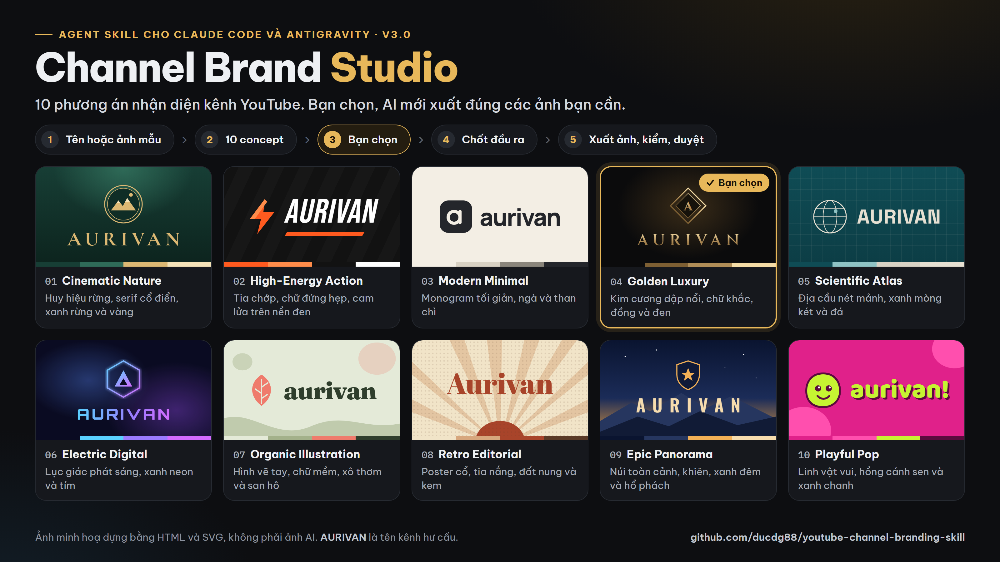
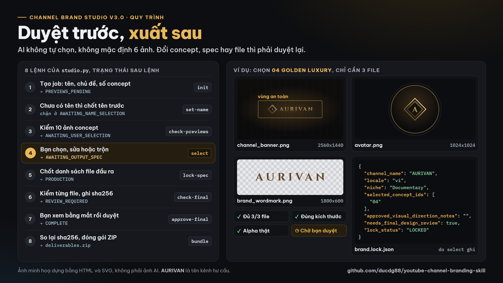

# Channel Brand Studio v3.0: 10 phương án nhận diện kênh YouTube bằng AI

**Tiếng Việt** | [English](README.en.md)



  

Agent Skill (file `SKILL.md`) giúp AI làm bộ nhận diện cho kênh YouTube theo kiểu **duyệt trước, xuất sau**: đưa ra **10 phương án thương hiệu khác hẳn nhau** (biểu tượng, chữ tên kênh, bảng màu, kiểu chữ), **bạn chọn**, rồi mới xuất **đúng các file bạn cần** và tự kiểm từng file. Dùng được với Claude Code, Google Antigravity, Gemini CLI, Codex và mọi agent đọc `SKILL.md`. Do [DUCPT](https://ducpt.com/?utm_source=github&utm_medium=readme&utm_campaign=youtube-channel-branding-skill) làm và dùng thật cho các kênh của mình.

## Có gì mới ở v3.0

- **10 concept xem trước, không phải 10 ảnh thành phẩm.** Mặc định 10, chọn được từ 1 đến 20. Mỗi concept là một hướng thương hiệu trọn vẹn, không chỉ đổi màu.
- **AI không tự chọn.** Chưa có lựa chọn của bạn thì trạng thái là `AWAITING_USER_SELECTION` và dừng chờ.
- **Không mặc định 6 ảnh.** Bạn chọn đầu ra: chỉ avatar và banner (2 file), hay thêm wordmark, logo ngang, watermark, kích thước và định dạng tuỳ ý. Bộ 6 ảnh cũ chỉ là profile `REFERENCE_6` tuỳ chọn.
- **Một file khoá chung** `brand.lock.json` sau khi chọn, nên mọi file sau không lệch tên, màu, chính tả.
- **Đổi gì cũng phải duyệt lại.** Chọn lại concept, chốt lại spec, kiểm lại ảnh hay sửa một file sau khi duyệt thì lần duyệt cũ mất hiệu lực; `bundle` so lại sha256 từng file trước khi nén.
- **QA không giả được.** Script kiểm số file, kích thước, định dạng, nền trong suốt thật; `technical_pass` không có nghĩa là đã duyệt mỹ thuật, bạn vẫn phải xem bằng mắt.



## Quy trình

| Bước | Lệnh `studio.py` | Trạng thái sau lệnh | Việc |
|---|---|---|---|
| 1 | `init` | `PREVIEWS_PENDING` (chưa có tên: `AWAITING_NAME_SELECTION`) | Tạo job: tên kênh, chủ đề, số concept |
| 2 | `set-name` | `PREVIEWS_PENDING` | Chốt tên khi nhờ AI gợi ý; chưa chốt thì không kiểm ảnh, không chọn được |
| 3 | `check-previews` | `AWAITING_USER_SELECTION` (lỗi: `PREVIEWS_INCOMPLETE`) | Kiểm 10 ảnh concept (1 đến 20), mỗi ảnh một file |
| 4 | `select` | `AWAITING_OUTPUT_SPEC` | Bạn chọn, sửa hoặc trộn; ghi `brand.lock.json` |
| 5 | `lock-spec` | `PRODUCTION` | Khoá danh sách file, kích thước px, định dạng, nền trong suốt |
| 6 | `check-final` | `REVIEW_REQUIRED` (lỗi: `PRODUCTION_INCOMPLETE`) | Kiểm từng file, ghi kích thước và sha256 |
| 7 | `approve-final --confirmed` | `COMPLETE` | Bạn xem bằng mắt và duyệt |
| 8 | `bundle` | `COMPLETE` | ZIP gồm file, `brand.lock.json`, spec, báo cáo QA, `manifest.json` |

## Cài đặt

Tải repo rồi chép thư mục `skills/channel-brand-studio` vào chỗ agent đọc skill:

| Agent | Chép vào |
|---|---|
| Claude Code (mọi dự án) | `~/.claude/skills/channel-brand-studio/` |
| Claude Code (một dự án) | `<dự án>/.claude/skills/channel-brand-studio/` |
| Google Antigravity | `<dự án>/.agents/skills/channel-brand-studio/` |
| Agent khác | đính kèm `SKILL.md`, `docs/WORKFLOW.md`, `docs/CLAUDE_BUILD_PROMPT.md` |

```bash
git clone https://github.com/ducdg88/youtube-channel-branding-skill.git
cp -r youtube-channel-branding-skill/skills/channel-brand-studio ~/.claude/skills/
pip install pillow   # cho bước kiểm ảnh
```

## Chạy thử luồng (Python 3.9 trở lên)

Chạy trong thư mục `skills/channel-brand-studio`:

```bash
python scripts/studio.py init --dir ./test_job --niche "Example topic" --name "EXAMPLE BRAND" --count 10
python scripts/studio.py status --dir ./test_job
# job tạo không có --name thì chốt tên trước: python scripts/studio.py set-name --dir ./test_job --name "Tên Kênh"
# nối máy tạo ảnh, lưu 10 ảnh thật vào test_job/previews/01.png ... 10.png
python scripts/studio.py check-previews --dir ./test_job
python scripts/studio.py select --dir ./test_job --ids 03
# chỉ sau khi người dùng duyệt mới khoá đầu ra:
python scripts/studio.py lock-spec --dir ./test_job --spec configs/sample_custom_assets.json
# xuất file đúng spec vào test_job/final/, rồi kiểm:
python scripts/studio.py check-final --dir ./test_job
# khách xem bằng mắt và đồng ý:
python scripts/studio.py approve-final --dir ./test_job --confirmed
python scripts/studio.py bundle --dir ./test_job
python tests/test_studio.py   # kiểm các cổng trạng thái
```

Script chỉ quản lý trạng thái, viết brief và kiểm file. Nó **không tự gọi máy tạo ảnh trả phí** và không deploy web. Không có máy tạo ảnh thì skill chỉ đưa ra đề xuất concept có ghi nhãn, không giả vờ đã có ảnh.

## Bên trong skill

```
skills/channel-brand-studio/
  SKILL.md                    # quy trình 8 bước, cổng duyệt, giới hạn
  docs/WORKFLOW.md            # bảng trạng thái, wizard cho web thương mại, QA
  docs/CLAUDE_BUILD_PROMPT.md # prompt giao AI dựng web white-label
  docs/USER_GUIDE_PUBLIC.md   # hướng dẫn 5 bước cho người dùng cuối
  configs/                    # defaults, CUSTOM mẫu 3 file, REFERENCE_6 tuỳ chọn
  scripts/studio.py           # init, set-name, status, check-previews, select, lock-spec, check-final, approve-final, bundle
  scripts/demo_gallery.py     # dựng trang HTML minh hoạ bảng chọn
  examples/                   # 10 brief concept trung tính, trang minh hoạ có nhãn mockup
  tests/test_studio.py        # kiểm cổng: chưa chốt tên, chưa chọn, chưa duyệt, file đổi sau QA đều bị chặn
```

## Ảnh minh hoạ trong README

Hai ảnh trên dựng bằng HTML và SVG, nguồn ở `docs/demo/` (`cover.html`, `workflow.html`, `concepts.js`, `demo.css`). Tên kênh AURIVAN là tên hư cấu, không phải ảnh do AI tạo. Dựng lại bằng Chrome chạy ẩn:

```bash
chrome --headless=new --hide-scrollbars --window-size=1600,900 --force-device-scale-factor=2 --virtual-time-budget=15000 --screenshot=docs/cover.png docs/demo/cover.html
```

## Bản cũ v1.3: universal-youtube-branding

Thư mục `skills/universal-youtube-branding/` vẫn giữ nguyên cho ai đang dùng: một thương hiệu, mặc định 6 ảnh (`REFERENCE_6`), có `MODE=NAME` đặt 20 đến 30 tên và SEO, `MODE=VISUAL`, `MODE=FULL`, script `validate_assets.py`, `init_project.py`, `build_prompts.py`, `niche_router.py` và bộ mẫu GRAINVEYRA ở `examples/luxury_woodworking/`.

```
/universal-youtube-branding MODE=FULL NICHE="Luxury Woodworking" STYLE=AUTO MARKET=Global
python skills/universal-youtube-branding/scripts/validate_assets.py <thư mục dự án> --profile reference6 --report qa_report.json
```

Cần nhiều phương án để chọn trước khi xuất ảnh thì dùng v3.0.

## Giới hạn

- Tìm tên chỉ hỗ trợ rà soát, không chứng minh tên hay @handle chưa ai dùng; kiểm trong YouTube Studio. Không tra nhãn hiệu.
- QA kỹ thuật không bắt được chữ sai trong ảnh hay logo xấu; luôn xem bằng mắt.
- Ảnh mẫu bạn đưa phải có quyền dùng. Không làm logo giả kênh hay thương hiệu khác.
- Không kèm font, khoá API hay dữ liệu kênh của khách. Chất lượng ảnh phụ thuộc máy tạo ảnh bạn nối vào.

## Về DUCPT

[DUCPT](https://ducpt.com/?utm_source=github&utm_medium=readme&utm_campaign=youtube-channel-branding-skill) làm công cụ AI, quy trình tự động và đào tạo cho người làm nội dung, kênh YouTube và doanh nghiệp nhỏ ở Việt Nam:

- [DUCPT Skills](https://ducpt.com/skills/?utm_source=github&utm_medium=readme&utm_campaign=youtube-channel-branding-skill): bộ Agent Skill miễn phí cho người làm một mình với AI
- [YouTube Title Lab](https://ducpt.com/skills/youtube-title-lab/?utm_source=github&utm_medium=readme&utm_campaign=youtube-channel-branding-skill): skill viết và chấm tiêu đề YouTube
- [Tìm Nguồn YouTube](https://ducpt.com/dich-vu/tim-nguon-youtube?utm_source=github&utm_medium=readme&utm_campaign=youtube-channel-branding-skill): tìm nguồn video cho kênh
- [Tab Cộng Đồng AI](https://ducpt.com/cong-cu-ai/tab-cong-dong-ai?utm_source=github&utm_medium=readme&utm_campaign=youtube-channel-branding-skill): viết bài Cộng đồng YouTube bằng AI
- [Khoá học](https://ducpt.com/khoa-hoc/?utm_source=github&utm_medium=readme&utm_campaign=youtube-channel-branding-skill): làm kênh và vận hành doanh nghiệp bằng AI

## Giấy phép

[MIT](LICENSE). Dùng, sửa, chia sẻ tự do; giữ dòng bản quyền.
